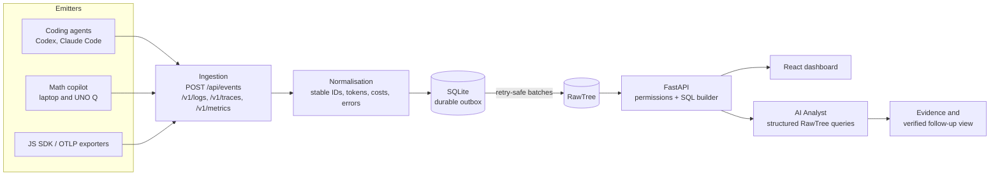

# DevFlight: observability for AI-assisted development, on RawTree


> **🏆 Winner of the Tinybird side challenge, "Best agentic use of RawTree", at the Datathon FME 2026 (UPC), 15 November 2026.**

DevFlight is a local platform that collects telemetry from the AI coding agents a team uses (for example Codex and Claude Code) and from a small math copilot, stores it in [RawTree](https://rawtree.com), and shows it in a dashboard with a conversational **AI Analyst**. We built it to watch ourselves build our Qualcomm main-challenge entry, [datathon-2026](https://github.com/jan-lozano-dev/datathon-2026): who ran what, which agent failed where, what it cost in tokens, and how each evaluation run compared with the last.

## Why RawTree

AI agents emit messy, evolving JSON: different fields per tool, numbers sent as strings, schemas that change from one session to the next. RawTree is a schemaless OLAP database: it creates tables on first insert and exposes new fields as SQL paths, so we did not have to fix a schema before the first event arrived. DevFlight puts the missing pieces around it: identity, permissions, durable delivery and an analyst that can query it safely.

## How it works



- **RawTree** keeps the analytic events.
- **FastAPI** applies permissions and builds the SQL. The RawTree and model-provider keys never leave the backend, and the analyst never receives credentials or arbitrary executable SQL.
- **SQLite** stores identities, analyst jobs, private views and a durable outbox, so an event is accepted locally before it is written remotely.
- **React** shows the dashboard and the analyst chat. The compiled frontend is included; Node is only needed to change it.

## What it does

- **Global dashboard:** activity, errors, emitters, sessions, reported token use and source status, over every compatible table of the authorised RawTree source.
- **Ingestion:** OTLP/HTTP JSON (logs, traces, metrics), flat events and the JavaScript SDK envelope, with stable IDs so retries do not duplicate events.
- **AI Analyst:** a conversation that chooses structured RawTree queries and keeps its progress, shows the SQL and the evidence, and can turn a finding into a saved follow-up view that a verification query then checks. Default limits per investigation: 3 iterations, 4 queries, 6,000 tokens and 60 s.
- **Experiments tab:** reads the `eval.grade` events of our Qualcomm project and breaks accuracy down by language, topic and level. It only calls two runs comparable when dataset, split, suite version and hardware match.
- **Explorer:** a virtual table over all events, filters, grouping, pagination, CSV export and private views.
- **Visible delivery:** what is pending, how old it is, the last attempt, the last confirmation and any error. Local acceptance, remote write confirmation and visibility in a query are different states.

## Try it

Python 3.11 or later.

```sh
python3 -m venv .venv
.venv/bin/python -m pip install ".[platform]"
cp .env.example .env            # then fill in the RawTree and Helmcode keys
.venv/bin/python start_platform.py start
```

On Windows: `py -3 -m venv .venv`, `.venv\Scripts\python.exe -m pip install ".[platform]"` and `devflight.cmd start`.

Open <http://127.0.0.1:8788>. The first start writes the admin credential to `.devflight/platform/admin.token`; paste it into the form and do not share the file. `status`, `restart` and `stop` manage the services. The app is served in Spanish.

To capture telemetry from a coding agent, see [docs/TELEMETRY_QUICKSTART.md](docs/TELEMETRY_QUICKSTART.md). Exporters send `Authorization: Bearer <credential>` to `POST /api/events`, `/v1/logs`, `/v1/traces` or `/v1/metrics`. For a live walkthrough, see [docs/DEMO.md](docs/DEMO.md).

## Tests

```sh
python3 -m unittest discover -s tests -q      # 85 tests, 2 skipped; passes on Linux, Python 3.12
npm --prefix frontend ci && npm --prefix frontend run build
```

Tests with real RawTree and Helmcode accounts are not automated; `python scripts/platform_demo.py --live` runs a real investigation once the keys are set.

## Honest limits

- Rows are events, not necessarily model requests. Token counts are the ones each provider reports; a missing value stays `null` and is never turned into zero cost.
- A shared API key does not identify all of its users: events without an origin ID show as unknown.
- Delivery is "at least once with deduplication", not exactly once. Local capacity is capped (512 MiB by default) and new events are refused with a retryable error when it fills.
- The AI Analyst needs a provider that serves the configured model (`HELMCODE_MODEL`). *Check connection* only reads the provider's catalogue.
- Official agent integrations need configuration and a restart of the agent's session. Finding a configured endpoint does not prove delivery, and nothing is captured retroactively.

More detail in [docs/reference.md](docs/reference.md).

## Repository

| Path | What |
|---|---|
| `devflight/` | Python package: collector, normalisation, RawTree client, analytics, AI Analyst, server |
| `frontend/`, `devflight/web/` | React and TypeScript source, and its compiled build |
| `sdk/` | JavaScript SDK |
| `copilot/`, `board/`, `predict.py`, `eval.py` | A small instrumented math copilot that emits the events DevFlight shows |
| `scripts/`, `tests/` | Demo and verification scripts, and the unit tests |
| `docs/` | Documentation ([index](docs/README.md)) |

## License

MIT, see [LICENSE](LICENSE).
